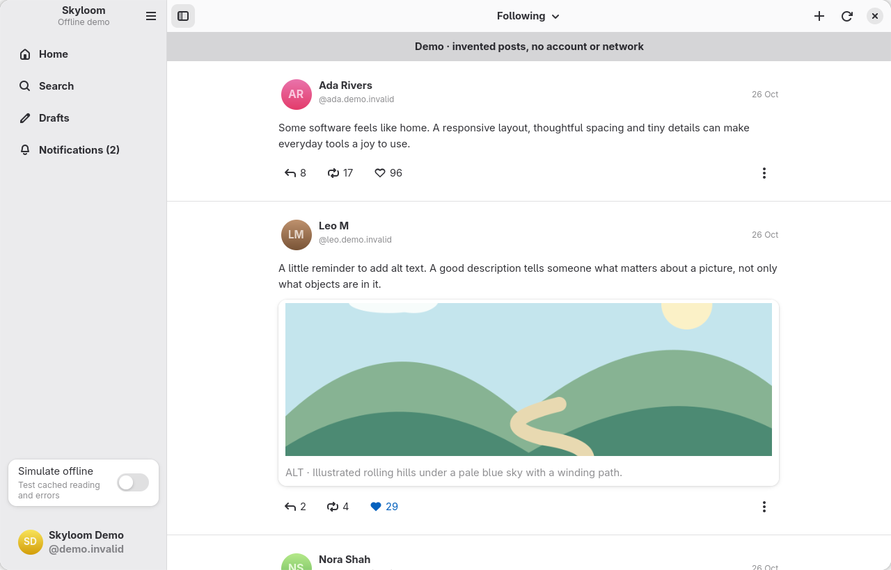

# Skyloom

A native GNOME client for Bluesky, built with GTK 4, libadwaita and Python. Independent of Bluesky. GPL-3.0-or-later.

Skyloom is a personal project by Nick Richards, shared for others to use, learn
from and adapt. Forks are warmly welcome, as are thoughtful bug reports and
contributions. Development follows the maintainer's interests and available time;
see [sharing and contributions](CONTRIBUTING.md) for what to expect.

This is a development preview. The account paths use the real AT Protocol SDK and have HTTP contract tests; a human live-account acceptance test is still required. See [the delivery report](docs/DELIVERY_REPORT.md) for exact evidence and remaining gaps.



Read Following and pinned feeds, open conversations and profiles, like/repost, reply or quote, and write posts with described images. Search posts/people, browse notifications, follow/mute/block accounts, and keep local drafts. The interface follows the system theme. The navigation toggle hides or restores the sidebar at any width; on narrow windows it opens a closable overlay. The same toggle is available on content pages.

## Install and launch

The preview currently targets **x86_64 and GNOME 51**. No hosted download is configured.
Build the local bundle using [the Flatpak instructions](docs/DEVELOPMENT.md#flatpak)
first. With that bundle and the runtime installed:

```sh
flatpak install --user dist/com.nedrichards.Skyloom-0.1.0-x86_64.flatpak
flatpak run com.nedrichards.Skyloom
```

Explore invented posts without an account or network:

```sh
flatpak run com.nedrichards.Skyloom --demo
```

Demo posts, reactions and publishing stay on this computer. Demo preferences use a memory backend and do not change your account preferences.

## Sign in safely

Create a **dedicated app password** at [Bluesky’s app-password settings](https://bsky.app/settings/app-passwords), then enter your handle and that app password in Skyloom’s native sign-in window. Never enter your main account password. Accounts on another PDS can set its HTTPS address under Custom server.

Startup resolves your saved session before showing Sign in. A delayed loading indicator appears only if lookup takes longer; lookup failures offer recovery rather than assuming you are signed out.

The app password is used transiently. Refreshable session tokens are stored through your login keyring, including after refresh. If the keyring is locked or unavailable, unlock it and retry; there is no plaintext fallback. Sign out removes the saved session and local account drafts, prepared images and cache. Server revocation is attempted and can fail if offline; you can also revoke the dedicated app password in Bluesky.

## Reading and writing

- Choose Following or a pinned feed from the header. Feeds share one visible row when space permits, scroll horizontally as space tightens, and become a dropdown at narrow widths. The chevron collapses or expands the strip without adding another header row. Refresh with Ctrl+R. Lists fetch the next page as you approach the bottom; Load more appears only for stalled loading or a download-policy override; errors pause automatic requests until you retry.
- Click or tap a post tile to read it in its conversation; quoted tiles open their own context. Author names, links, images and reaction controls keep their own actions. Alt+Left goes back to the same feed position.
- Profiles scroll as one page: full biography, controls, filters and posts move together. A compact identity appears in the toolbar as the large identity scrolls away. Search uses the full content height, with clear initial, loading, empty and retry states. Its fields scroll with results; Ctrl+K brings them back into view. Image descriptions scroll with the image, including long descriptions and large text.
- Selecting any feed comment opens its own message in the conversation view, including comments on other people’s threads. Conversations read parent before child, with sibling branches oldest first and each exchange kept together. Connected rails and “Opened here” identify context. Alt+Up/Down move to the loaded parent/first reply; the return-to-opened-post header action has Undo.
- Thread position pills appear on conversation cards in feeds, profiles, search, quotes and conversations. They appear once at least two connected posts are known and count known messages in reading order. Tooltips explain incomplete context. Home prefetches visible conversations after scrolling settles, and opened conversations load nearby context ahead of reading. Knowledge is shared across views.
- Replies load as their branch continuation comes into view; earlier messages load near the top, with manual loading/retry controls. Use Enter on a focused post or quoted card. Click text to open, with tolerance for small pointer movements; deliberately drag across text or double-click a word to select it. Clicking an existing selection dismisses it without opening the card. Image tiles open the native viewer; its header offers the browser action when available.
- Ctrl+N opens the composer; Ctrl+Enter publishes. Both the 300 grapheme and 3000 UTF-8 byte limits are enforced.
- Attach up to four JPEG/PNG images. Each requires a description. Upload copies are resized and re-encoded to remove metadata, including location metadata; originals are untouched.
- Drafts save locally and can be written and reopened offline; publishing remains disabled until connected. Cancel offers Keep, Discard or Continue writing. The Drafts destination restores reply/quote context too.
- A failed publication keeps the draft. After a timeout, check your profile before retrying: the server might already have accepted it.
- Labelled posts, media, quotes and profile biographies are visible by default, with compact label chips. Click a chip for an explanation, post/author scope, the original value and label preferences; extra labels remain available through the count chip. Hide content locally with the eye control, or enable Preferences → Warn about labelled content for a Show content card by default. Your explicit mutes/blocks remain separate, and content omitted by the server cannot be recovered by the client.
- Image descriptions are shown only when supplied; images without descriptions have no empty ALT section.
- Video opens externally. DMs, video upload, multi-account use, post deletion are not included.

Double-click or double-tap the active navigation destination to return to the top. Ctrl+Home does the same; the toast’s Undo button, U or Ctrl+Z restores your reading position. Pull down deliberately from the top on a touchscreen to refresh.

Use Down/Up or J/K to select posts, Home/End for the first/last loaded item, Page Up/Down or Space/Shift+Space to scroll, and Enter to open. Selection alone never opens a post or marks notifications read. F6/Shift+F6 switches panes, including narrow-window navigation. Ctrl+1–5 opens Home, Search, Notifications, your Profile and Drafts. With a post selected, R replies, Q quotes, L likes, Shift+R reposts, B opens Bluesky, M opens its menu and Ctrl+Shift+C copies its link. Text fields, selections, dialogs and focused controls keep their native keys and editor Undo.

Click your account card at the bottom of the sidebar to open your profile; Ctrl+4 does the same. Profile actions and the post filter share one row and wrap when needed.

Preferences and About are in the overflow menu. It stays in the sidebar while navigation is shown and moves to the current page header when hidden; F10 opens the visible menu. Sign out is at the bottom of Preferences, under Authentication. Ctrl+K searches; Ctrl+, opens preferences; F1 or Ctrl+? opens native shortcut help; F10 opens the main menu; Ctrl+Q closes the window, guarding an open draft.

## Staying up to date

Skyloom checks the visible Following/pinned feed or notifications list when it is at least five minutes old, while the window is active. New posts appear in a **Show** overlay notification without moving your reading position; Show jumps to the newest post, keeps overlapping loaded history, and has Undo to restore your reading position. Existing tiles are reused and visible arrivals get a short fade, respecting reduced motion. After dismissal, Show new items stays available in the overflow menu and on Ctrl+Shift+Home. Wheel/nearby top navigation gets a brief damped peek; jumps longer than a viewport go directly to the top. Smooth/touch overscroll stays native; reduced motion and power saver skip the effect. Inactive windows, dialogs and text editing pause refresh. Resume and reconnection recheck freshness without waking a sleeping computer. Failures back off to at most one automatic attempt every 30 minutes; explicit Refresh remains available.

Automatic paging and queued viewport media wait while the window is inactive and resume on activation. Freshness uses a single deadline rather than a minute poll. Automatic refresh, paging and uncached image downloads pause on metered or limited/offline connections and in power saver. Preferences shows the connection state and lets you allow automatic metered downloads or disable refresh. Saved posts and cached images stay readable offline, including when opening a saved post from the feed. Load more, Refresh and opening an image are explicit overrides. Connection information comes from the desktop’s network monitor; Skyloom does not guess Wi-Fi versus mobile. Notifications become read only through the explicit Mark seen action.

## Privacy

No analytics, polling while inactive, custom backend or broad home-directory permission. Automatic checks run only in an eligible active window. The sandbox has network, display/GPU/IPC and narrow Secret Service access. File attachment uses GTK’s portal-friendly file chooser.

Drafts and a bounded feed cache are stored in Skyloom’s private application data, not encrypted separately from your filesystem. Prepared image copies remain local until sign-out; remove sensitive drafts or sign out on shared computers. Automatic media downloads are restricted to Bluesky’s CDN, capped in size and cached in bounded memory and account-private disk storage (128 MiB / 2,048 images per account). Other image hosts fall back to descriptions/external viewing. Image downloads can be disabled in Preferences.

## Build and test

See [DEVELOPMENT.md](docs/DEVELOPMENT.md) for native Meson, Flatpak, tests and dependency regeneration. [Implemented features](docs/FEATURES.md), [architecture](docs/ARCHITECTURE.md), [testing](docs/TESTING.md), [changelog](CHANGELOG.md) and [delivery report](docs/DELIVERY_REPORT.md) describe the current app. Repeatable frame-timing measurements and current limits are in [the performance report](docs/PERFORMANCE.md). Outstanding release gates and optional features live in [the roadmap](docs/ROADMAP.md). The completed bootstrap plan has been retired.

The app identity is `com.nedrichards.Skyloom`; the maintainer and creator is Nick Richards. See [storage and retention](docs/ARCHITECTURE.md#storage-locations-and-retention) for local data locations.

## Licence

Skyloom's original code, documentation and artwork are licensed under the
[GNU GPL version 3 or later](LICENSE.md); the full text is in [COPYING](COPYING).
AppStream metadata is CC0-1.0 and dependencies retain their own licences.
